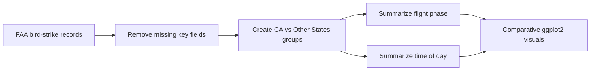

# FAA Bird Strike Analysis

### Compare collision-risk patterns in California and other U.S. states with R

[](https://www.r-project.org/)
[](https://ggplot2.tidyverse.org/)
[](https://quarto.org/)

Bird strikes create safety risks, operational disruptions, and financial costs for aviation. This R project explores when and where collisions occur by comparing California with other U.S. states across flight phase and time of day.

The primary implementation is R with tidyverse and ggplot2. A supplemental Python conversion is included for command-line reproducibility, but the original R workflow remains the representative project implementation.

## Contents

- [Why this matters](#why-this-matters)
- [Key findings](#key-findings)
- [Quick start in R](#quick-start-in-r)
- [Technical workflow](#technical-workflow)
- [Project structure](#project-structure)
- [Limitations and known issues](#limitations-and-known-issues)
- [Contribution](#contribution)
- [Support](#support)
- [License](#license)

## Why this matters

An airport or flight-operations team could use this analysis to ask:

- Which flight phases have the most reported collisions?
- Do California collision patterns differ from other states?
- Are collisions more common during daytime, dawn, dusk, or night?

The visuals are designed to make those comparisons easy to inspect rather than hide them behind a single score.

## Key findings

- Approach and landing account for a large share of collisions across regions.
- Other states show a stronger concentration in the approach phase.
- California collisions are more evenly distributed across several flight phases.
- Daytime collisions are more common than night, dawn, or dusk collisions in both groups.

## Quick start in R

### Prerequisites

- R 4.2 or newer
- RStudio recommended
- Quarto for rendering the report

```r
install.packages(c("tidyverse", "openintro", "gridExtra"))
```

Open `Final_Project.qmd` in RStudio, or run the reproducible script:

```r
source("bird_strike_analysis.R")
```

The supplemental Python conversion can be run with:

```powershell
python bird_strike_analysis_python.py
```

## Technical workflow



## Project structure

```text
FAA-Bird-Strike-Analysis/
├── birds.csv                       # FAA bird-strike data
├── Final_Project.qmd               # Primary Quarto report
├── bird_strike_analysis.R          # Primary R analysis
├── bird_strike_analysis_python.py  # Supplemental Python conversion
├── Myungje_Kim_Final_Project.pdf   # Rendered project report
└── README.md
```

## Limitations and known issues

- Reported collisions may reflect reporting and airport-traffic differences, not only underlying risk.
- The comparison is descriptive and does not estimate causal effects.
- The dataset does not include exposure measures such as flights or takeoffs by airport.
- The supplemental Python script is intended to reproduce the summary workflow, not replace the R report.

## Contribution

Open an issue with a reproducible example, keep primary analysis changes in the R files, and include rendered output or a clear description of visual changes in a pull request.

## Support

Use GitHub Issues or connect with [Myungje Kim on LinkedIn](https://www.linkedin.com/in/evan-kim-257857249/).

## License

No open-source license has been specified yet. Contact the repository owner before redistributing or adapting the code.
